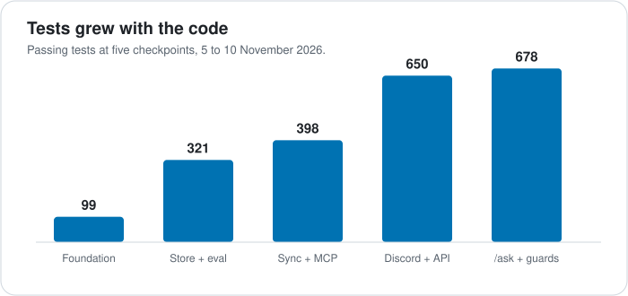

# How teamctx was built

This is the build log: why the project exists, what went wrong along the way, and how it
was tested before it ever met a real Discord server. It is written in the first person by
the maintainer, and it is meant to be read in about ten minutes.

**One thing up front:** I built this with AI coding agents (Claude Code and Codex), working
as the lead engineer who sets the plan, splits the work, reviews the results and decides.
Agents wrote much of the code. I did not trust it on faith, and a good part of this story
is about how I checked it.

- [Where it started](#where-it-started)
- [Research before code](#research-before-code)
- [How the build ran](#how-the-build-ran)
- [The walls](#the-walls)
- [Simulations: testing without a real server](#simulations-testing-without-a-real-server)
- [By the numbers](#by-the-numbers)
- [What is not done](#what-is-not-done)
- [What I would tell someone starting a project like this](#what-i-would-tell-someone-starting-a-project-like-this)

## Where it started

My team coordinates in Discord. Like most small teams, we decide things there: which book
to demo, who owns the intro, what the deadline is. Then the decision scrolls away. Someone
asks again, or acts on the old answer, or has to read 300 messages to catch up after a day
off.

I also use AI coding agents, and they had the same problem from the other side. They know
the code and nothing about what the team decided, so they build the wrong thing or ask me
to explain it again.

At the start of November 2026 I built a private prototype for my own team: a shared
read-only bot plus a small MCP server so our agents could read the Discord channels. It
worked well enough to show the idea was worth something. An agent could answer "who is
presenting, and what is the deadline?" without anyone repeating it.

It also showed me what was wrong with it:

- **One shared bot token** for the whole team, which is a lot of trust in one secret.
- **My PC had to be on** for anyone to get context.
- **Everyone had to install Python** and run a setup script. That was the biggest hurdle
  for teammates.
- **An agent loop** answered questions by calling tools over and over. It was slow, hard
  to bound and hard to test.
- **Permission checking needed more care.** Discord channel overrides decide what a bot
  can really see, and getting them exactly right is harder than it looks.

So I did not continue it. I started a clean repository, kept the lessons and none of the
code or data (ADR [0010](adr/0010-clean-rebuild-from-prototype.md)), and wrote down what
the real thing should be.

## Research before code

The first idea was "a read-only Discord MCP server". Searching GitHub showed that space was
already crowded with plain API wrappers. A wrapper gives an agent raw messages; it does not
tell it what the team *decided*. That decided the pitch:

> Keep a **cited record** of decisions, tasks and open questions that people and agents can
> ask, and make it work without an LLM.

Other findings shaped the design before any code existed:

- Discord's developer policy bans using message content to train models, and Slack's terms
  limit persistent indexes for commercially distributed apps. A **self-hosted, per-team**
  program that never trains anything is the shape that fits those rules.
- Entries should be **captured by people**, not guessed by a model. A wrong auto-extracted
  "decision" is worse than a missing one.
- **Chat is untrusted input.** Anyone can type instructions into a channel, and an agent
  reading the channel might follow them. So every output that carries chat text is fenced
  as data.
- **Read-only towards Discord**, enforced by asking for two permissions and by a test that
  fails if the code ever calls a write endpoint.

I wrote this up as a plan with 13 assumed decisions, 14 architecture decision records
(ADRs) and nine milestones, each with "done when" criteria. The rule for the rest of the
project: read the plan first, ask if it is missing something, do not invent requirements.

## How the build ran

Work was split into tasks with explicit owned files, run in parallel waves, each agent in
its own git worktree. After each wave an independent reviewer (a second model) read the
combined changes. I merged only after the checks I had named in advance had actually run:
formatting, lints with warnings as errors, all tests, a dependency audit, a minimum
supported Rust version check, and the retrieval eval.

| Date (2026) | What happened |
|---|---|
| Nov 2 | Private prototype snapshot. Lessons collected. |
| Nov 4 | Research, plan, ADRs 0001 to 0014, CI on three operating systems, security workflows (M0). |
| Nov 5 | Spikes for MCP over HTTP and bundled SQLite full-text search. Core types, SQLite store, fictional demo team, retrieval eval, tokens and auth, Discord event mapping, MCP tools, sync against a fake Discord, the bot setup guide. Audit and rebuild of weak parts. Public-release cleanup. |
| Nov 10 | The team host (`teamctx run`), slash commands and context menus, export, JSON API, CLI client, Agent Skill, and `/ask`. First big pull request merged. Code-scanning fix. |

That is a calendar week of part-time work. It is not a claim about hours or effort, and
the live Discord checks are still ahead of me.

## The walls

Nothing in this list is a surprise to anyone who has shipped software. They are here
because I hit every one, and because the fixes are the interesting part.

### The first pitch was already taken

A read-only Discord MCP server is a crowded niche. I found that out on day one by
searching before building. The pivot to a *team record* changed the whole project.

### The agents hit their usage limit, repeatedly

Long sessions stopped on my AI coding quota in the middle of a wave more than once. What
saved the work was boring: briefs, checkpoints and a state file that said exactly what was
merged, what was half done and what to do next. A second agent (Codex) picked the
unfinished sessions up, finished the tasks and wrote down what it verified. Lesson: write the handoff notes as if
the next worker has no memory, because it does not.

### My own audit found the demo data was slop

The first demo dataset was a ten-line template repeated thirty times. It passed its tests
and proved nothing. I rebuilt it: a fictional six-person team, 314 messages written the way
teams write (one loud person, one quiet person, typos, decisions that are only implied,
long planning posts next to one-word replies), 76 record entries, 14 decisions that were
later reversed, and eight conversations that reuse the *words* of real topics without
answering anything, to trip up naive keyword matching. A validator checks that paraphrased
questions do not simply reuse the answer's vocabulary.

The audit also caught SQL written as 736-character lines and a migration nobody needed
before a first release. Both were refactored.

### The first eval baseline was all zeros

The retrieval eval's first baseline was 0.00 across the board. Bare words in a query were
joined with AND, so a natural question like "what did we decide about the beta date"
matched nothing. A CI gate pinned at zero cannot catch a regression. I changed to any-word
matching with stopword removal and measured it: recall@10 rose from 0.00 to 0.61 on the raw
store search.

Then I made the eval stricter. It now runs the *production* retrieval path with the same
10-result cut-off the CLI uses, and the headline number fell to **0.54** (and 0.65 for the
`/ask` bundle). The lower number is the honest one. Paraphrase questions, where the
question shares few words with the answer, are still weak at 0.27. That gap is why
embeddings are on the roadmap.

### Review found real bugs

Independent review across the waves found five high-severity (P1) and more than a dozen
medium findings. Every one got a regression test that fails without the fix. The ones that
taught me most:

- **A revoke race:** an access token could be used in the instant it was being revoked.
- **A rate-limiter race:** concurrent failed token attempts could slip past the limit.
- **A budget race:** concurrent `/ask` calls could spend past the cap, because the budget was
  checked before it was reserved.
- **A markdown link bypass:** a link in a model answer could slip past URL stripping.
- **One long query pinned the CPU.** A 100,000-word search took about eight seconds. Query
  size and clause count are now bounded.

### The secret guard leaked the secret

CI showed green workflows, but a separate code-scanning check was red: a high-severity
"cleartext logging" alert in a **test written to prove secrets never reach logs**. When that
test failed, its failure message printed the secret it was guarding. I had also let the
agent report "all green" on the workflow result alone. The lesson: read the actual
check-runs and the alert list, not just the workflow conclusion. The fix replaced the
diagnostic with fixed text, added a regression that fails if the old behaviour returns,
and a second alert of the same kind was fixed by reporting leaks by *position* rather than
by secret-derived text.

### A dependency advisory

`cargo deny` flagged a security advisory in the MCP SDK version I had chosen. Bumping it
was easy; the point is that the audit ran on every pull request, so it was found in
minutes instead of after release.

### My email was in the public history

I noticed a personal email address in the commit history of a public repository. With my
approval the history was rewritten to the GitHub noreply address and force-pushed, with the
branch ruleset briefly lifted and restored. Old pull request refs can still expose the old
identity, and only GitHub Support can purge those. Set the noreply address and "keep my
email private" **before** the first commit, not after the repository is public.

### I do not want a real bot token near a test harness

To test the live paths, my first plan was a real server with extra "driver" bots. I
rejected it: more real tokens, more setup, nothing repeatable and nothing that could run in
CI. Creating a real test server also needs a human to accept Discord's guidelines, and my
automation was not going to click that for me. That pushed me to the simulation below, and
to a deliberate design constraint: teamctx will accept a different Discord API address only
if it is **loopback** (this machine), so a bad config can never send a bot token to a
stranger's server (ADR 0016, still in review).

## Simulations: testing without a real server

Until a real Discord test server exists, nothing can claim to work "live". Here is what I
built instead, and what each layer does and does not prove.

| Layer | What it is | What it proves | What it cannot prove |
|---|---|---|---|
| **A fictional team** | "Lantern Shelf": 6 people and a bot, 4 channels, 6 threads, 314 messages, 76 record entries, 2 planted prompt-injection messages | Search, ranking and the record behave on realistic, messy chat | That real Discord data looks like this |
| **Retrieval eval** | 62 questions in five types (date, name, reversed decision, paraphrase, thread context), scored by recall@10 and MRR, gated in CI | Retrieval quality is measured and cannot silently regress | Quality on a real team's vocabulary |
| **Recorded and synthetic Discord payloads** | Gateway events, REST responses and interactions as fixtures, plus a fake REST client | Every event type maps correctly; sync handles catch-up, edits and deletes | That Discord still sends exactly these shapes |
| **A fake model** | A scripted provider instead of a real LLM | The `/ask` pipeline, citation checks, URL stripping and budgets | What a real model does with the prompt |
| **A hostile-message corpus** | 30+ attacks across ten classes: instruction override, fake delimiters, bidi and zero-width characters, markdown links, fake citations and more | Chat text stays fenced through MCP, the API and `/ask` | Attacks nobody has thought of yet |
| **Clean machines** | A throwaway Linux VM that runs the CI checks, and a Windows Sandbox setup for running the release binary on a clean install | It builds and passes outside my own machine | macOS locally (CI covers it) |
| **A local Discord emulator** *(in progress)* | A scripted run of the real `teamctx run` binary against an open-source Discord emulator: six scripted users chat over four "acts", the host goes offline and catches up, the gateway drops and resumes, people capture entries with the real commands, and a checker scores everything against ground truth | The whole binary end to end, repeatably, with no real tokens | Discord's real rate limits, threads and permissions quirks |
| **A real test server** *(next)* | A throwaway server and bot | The two things only Discord can settle: gateway messages arrive with content, and interaction replies work without the Send Messages permission | Nothing else needs it |

The emulator harness is drafted and has not run end to end yet. It needs the loopback API
address setting from ADR 0016 first. I am saying so plainly because "simulated" is easy
to over-claim.

## By the numbers

| What | Value |
|---|---|
| Automated tests passing | 678 on Windows, 683 in the Linux VM |
| Operating systems in CI | Linux, macOS, Windows (plus a static Linux build) |
| Architecture decision records | 14 accepted |
| Demo team | 314 messages, 76 entries, 62 eval questions |
| Retrieval recall@10 | 0.54 for search, 0.65 for the `/ask` bundle |
| Hostile messages in the corpus | 30 or more |
| Checks before a merge | formatting, lints as errors, tests, dependency audit, minimum Rust version, eval gate, CodeQL, workflow lint |

Numbers were measured on 10 November 2026 and are reproducible with `cargo test --workspace`
and `cargo xtask eval -- --check`.

## What is not done

I would rather you hear it here than find it out.

- **It has not run against a real Discord server.** Live sync, the slash commands and the
  two spikes that settle the Rust go/no-go are all waiting on a test server.
- **`/ask` has only met a fake model.** No hosted or local model has answered a real
  question through it yet.
- **There is no web view yet.** A simple read-only one is planned.
- **Paraphrase search is weak** (0.27 recall@10) until embeddings or query expansion land.
- **There is no release.** `v0.1.0` waits for the live checks, a final name and a clean
  install on a fresh machine.

The [roadmap](roadmap.md) has the plan, in order.

## What I would tell someone starting a project like this

1. **Search before you build.** My first idea was taken, and finding out on day one was
   cheap.
2. **Write "done when" before the code.** It is the only thing that lets you say no to an
   agent that says it is finished.
3. **Make the eval able to fail.** A gate pinned at zero protects nothing.
4. **Audit the agent's output like a stranger's pull request.** Mine shipped placeholder
   data and tangled SQL that tests did not catch.
5. **Read the checks, not the summary.** "All green" was wrong once.
6. **Treat chat as hostile input**, even from your own team, even in your own tests.
7. **Write handoff notes for a worker with no memory.** You will need them the day your
   quota runs out.
8. **Fix the commit identity before the repo is public.**
